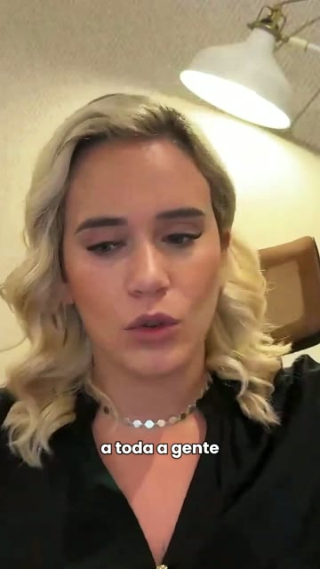
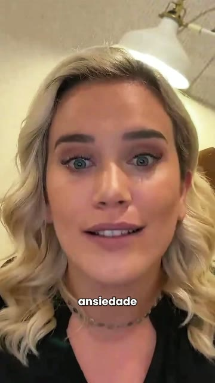
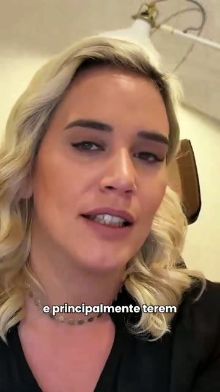

# Estilo Cortes e Legenda

O jeito que a Rafaela já edita hoje: **ela falando, os cortes que tiram pausas e repetições, e a legenda**. Nada mais na tela. É o padrão dela e o estilo dos cortes de live. A força do vídeo é a fala; a edição só tira o que atrapalha e deixa ler sem som.

  

De onde veio: o Reel dela [O cérebro humano prioriza padrões conhecidos](https://www.instagram.com/reel/DgDFBXlq4EQ/ "video") (2026-11, analisado em 2026-11-26): 93 s, 6 cortes (4 por minuto), nenhum texto além da legenda, nenhum efeito sonoro, música uns 20 dB abaixo da voz.

## Gravação

- Qualquer uma em que ela fale para a câmera: selfie bem perto do rosto (o normal dela), a câmera na mesa ou um trecho de live.
- O pedido final pode vir gravado à parte (no Reel de origem, o convite para o evento é outra gravação, emendada no fim).

## Na tela

| Elemento | Como é |
|---|---|
| Legenda | Frase curta, de 2 a 4 palavras (até uns 22 caracteres), inteira de uma vez, trocando na pausa e no ponto. Branca, Poppins em negrito, uns 54 px, com contorno escuro fino. Centrada, logo abaixo do queixo (no selfie, por volta de y 1420; numa live recortada, abaixo do peito, por volta de y 1500). Sem caixa, sem palavra em outra cor |
| Cortes | Pausa longa, repetição, frase que ela recomeçou, "eh", "hã" solto, falar com o chat. O corte é seco |
| Zoom | Seco e pouco: alterna entre 1 e 1,06 na troca de ideia (a cada 10 a 20 s), para o corte não parecer salto. Nunca zoom lento, nunca em frase sobre sofrimento |
| Nada mais | Sem título, sem animação, sem emoji, sem efeito sonoro |

- **A legenda nunca cobre a boca** e nunca encosta nas laterais (uns 90 px de margem).
- **A legenda é a fala dela, em português de Portugal.** "Está a acontecer", "convosco", "sítio": como ela disse.

### Com rótulo (opcional)

Quando o vídeo responde a uma pergunta ou trata de um assunto só ("Sinais físicos da ansiedade", "Porque é que a ansiedade volta?"), um **rótulo fixo no topo** o vídeo inteiro: caixa branca arredondada, texto escuro em Poppins negrito, uns 44 px, em uma ou duas linhas, por volta de y 260. Ele diz do que é o vídeo para quem chega no meio. Use só quando quem opera pedir, ou num corte de live em que o começo precisa de contexto.

## Som

- **Sem efeito sonoro.**
- **Sem música no vídeo editado,** a não ser que mandem o arquivo. A música entra ao postar, pela biblioteca do Instagram ou do TikTok (no Reel de origem, ela fica uns 20 dB abaixo da voz: bem no fundo).
- O tratamento de voz normal do `cortar`.

## Como montar

1. Corte normal (`tentativas` se ela repetiu frases, `transcrever`, `cortar`). Sem recorte da pessoa.
2. No `roteiro.json`:

```json
{
  "legenda": { "classe": "leg-frase", "modo": "karaoke", "caracteres": 22, "sem_ponta_curta": true, "x": 90, "largura": 900, "y": 1420 },
  "css": ".leg-frase { font-family: var(--f-caixinha), sans-serif; font-weight: 700; font-size: 54px; line-height: 1.15; color: #fff; -webkit-text-stroke: 7px rgba(0,0,0,.82); paint-order: stroke fill; text-shadow: 0 2px 12px rgba(0,0,0,.35); } .leg-frase .leg-futura { opacity: 1; color: #fff; }",
  "camadas": [
    { "tipo": "zoom", "em": 0, "escala": 1.0 },
    { "tipo": "zoom", "em": "@PALAVRA", "escala": 1.06, "dura": 0 },
    { "tipo": "zoom", "em": "@OUTRA", "escala": 1.0, "dura": 0 }
  ]
}
```

   - O modo karaokê com `.leg-futura` acesa mostra a frase inteira de uma vez, que é o jeito dela.
   - `y` da legenda: confira no quadro e ponha logo abaixo do queixo.
   - O zoom não tem som. Toda camada de texto ganha um clique sozinha: no rótulo, ponha `"som": false`.
   - Com rótulo, acrescente uma camada `texto` do começo ao fim, com `"som": false` e a classe do rótulo no `css` (caixa branca, `border-radius: 28px`, `padding: 14px 30px`, cor `#1E293B`).
   - Música só se quem opera mandar o arquivo e puder usá-lo: camada `{"tipo": "som", "arquivo": "musica.mp3", "em": 0, "ate": FIM, "ganho": -12}`, bem no fundo. O normal é pôr ao postar.
3. `montar`, olhar os quadros (a legenda abaixo do queixo, sem cobrir a boca, sem palavra partida), `renderizar`, `finalizar`. Sem efeito, a `escuta` não é necessária.
