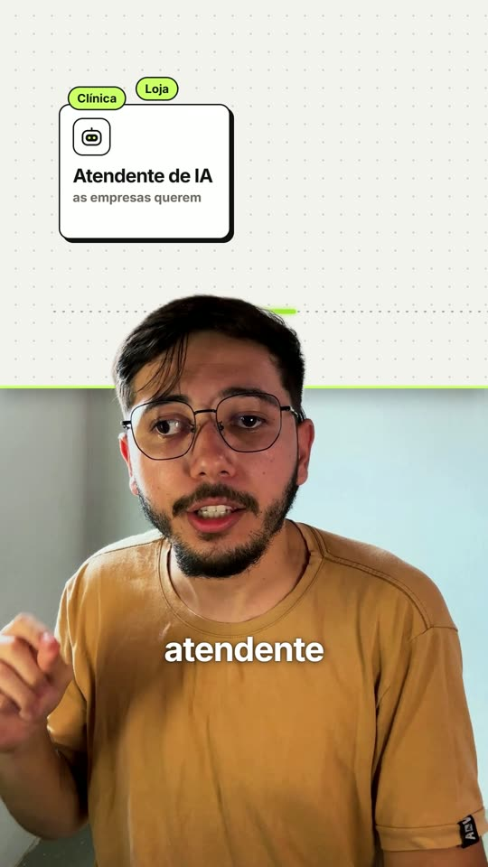

# Estilo Metade

Um painel ocupa a metade de cima da tela e a pessoa fica embaixo, com **a cabeça passando por cima da borda do painel**. No painel, as animações mostram o que a pessoa fala: a tela do sistema, a conversa, o resultado. Bom para explicar uma ferramenta, um processo ou um produto.

   

## Gravação

- **Parede livre acima da cabeça**: o vídeo desce uns 170 px para o rosto caber embaixo do painel, e a cabeça passa uns 200 px por cima da borda.
- Câmera parada, vídeo em pé, a pessoa no centro.

## Na tela

- **Um painel só para o vídeo inteiro**, claro e de prancheta de pontos, com um fio colorido na borda de baixo. Ele não some entre as cenas: as cenas são estações numa faixa, e a câmera anda de uma para a outra (ou o painel cresce, encolhe e sobe numa transição de 0,4 s). Nada de corte seco entre as montagens.
- **A cabeça passa por cima do painel** (`"cabeca_por_cima": true` e o recorte da pessoa).
- **Cartões** brancos com contorno escuro grosso e sombra dura deslocada; destaque na cor `metade` da marca (verde-limão no padrão) atrás da palavra, como marca-texto (veja `mm-base.css` nos exemplos).
- **O conteúdo fica na parte de cima do painel**, até uns 640 px: embaixo está a cabeça.
- **Nos trechos em que a pessoa brinca com a câmera, fica só ela**: o painel sobe e some.
- **Sem frase grande solta na cara da pessoa**: nos trechos só dela, fica só a legenda.
- **Legenda** sem serifa grossa, palavra por palavra, abaixo do queixo (o rosto fica logo abaixo do painel).
- **Nada parado:** depois de entrar, algo continua se mexendo, de preferência a própria interface (digitação, contador, barra, cursor, a prancheta andando) em vez de flutuação em loop, que parece artificial. Cada cena sai em fade curto (`"sai": .18`).
- **No pedido final:** "comenta X" mostra a caixa de comentário com a palavra sendo digitada; num anúncio, o botão ou o cartão apontando para o link.

## Som

Clique nos cartões, teclado na digitação, notificação na mensagem, whoosh em cada troca de estação. Os efeitos um pouco abaixo do padrão: `"efeitos": {"ganho": -3}`.

## Como montar

1. Corte normal e o recorte da pessoa (`recortar`, demora no processador).
2. Uma animação de painel para o vídeo inteiro, posta primeiro, e uma animação por cena. O `mm-palco.html` dos exemplos só muda a altura do painel (meio, cheia, fora); a prancheta que anda de estação em estação, como uma câmera, você cria para o vídeo. A base dos cartões é o `mm-base.css`, incluída dentro do `<style>` de cada cena, com a cena envolvida num `
`. Veja `mm-titulo.html`.
3. No `roteiro.json`: `"recorte"`, `"cabeca_por_cima": true`, camadas `zoom` com `"y": 170` e `"dura": .42` para o vídeo descer junto com a entrada do painel, e em cada animação `"legenda_y"` (e `"legenda_classe": "leg-clara"` em fundo claro).
   - **O painel e as cenas dentro dele levam `"atras": true`**: é isso que os põe entre o vídeo e o recorte, para a cabeça passar por cima. Sem ele, o painel cobre a cabeça.
   - O que fica na frente do peito (o adesivo do link, as etiquetas) vai sem `atras`.
   - **Legenda abaixo do queixo**, por volta de y 1400: logo abaixo do painel está o rosto.
4. `montar`, olhar os quadros, `renderizar`, `escutar`, `finalizar`.

## Num corte de live

Teste de 2026-11-26, no corte "Bruxismo, a raiva que ficou calada" (16 s), aguardando a aprovação do Vitório:

- **O vídeo-base é o `base-topo` de 400 px** (`live.py abrir-topo ... --px 400`), e não o zoom com `"y": 170`: a cabeça na live fica quase no topo. O recorte é feito desse mesmo vídeo (`recortar .../corte/base-topo400.mp4`).
- **O recorte é o passo pesado:** 3,4 min para 16 s no PC do Vitório (com placa de vídeo, mas o recorte roda no processador no Windows). No notebook da Rafaela, sem placa, conte muito mais: **avise antes, e para corte longo pergunte se vale.** O Vitório avisou que este estilo tem grande chance de não rodar no computador dela.
- **Cor do destaque:** o azul claro da marca (`:root { --c-metade: #9FD3E6; }` no `css`), no lugar do verde-limão.
- **Cenas do assunto dela:** o cartão "Bruxismo" com duas etiquetas numeradas; "está ligado à **raiva**" e um balão de fala com três pontinhos que a fita vermelha "CALADA" cala em "não disse"; "Passado → Agora" e a etiqueta "✓ trabalha-se em consulta".
- **Legenda** `leg-forte` em y 1680 (num corte perto da câmera, mais acima ela cai na boca); **efeitos** em `"ganho": -10` (o tom dela é calmo).

**Anúncio:** animação nova a cada criativo. O Facebook trata criativo parecido como igual.
