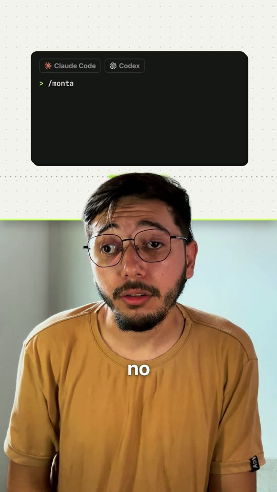
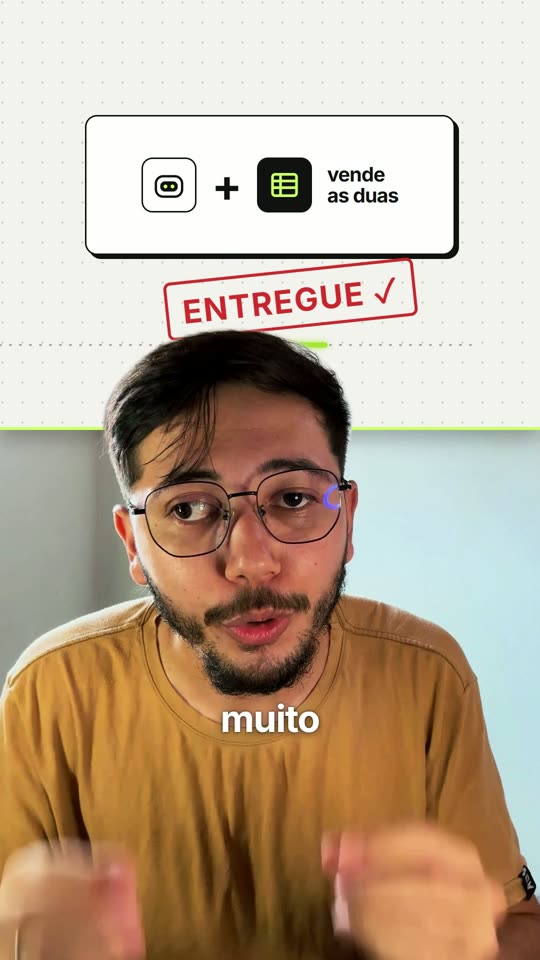

# Estilo Metade

Um painel ocupa a metade de cima da tela e a Rafaela fica embaixo. No painel, as animações mostram o que ela fala: o processo, as etapas, a ideia em cartões. Bom para explicar um método ou como algo funciona.

**Sem recorte** (Vitório, 2026-11-26): o painel acaba acima da cabeça dela, e a cabeça não passa por cima da borda. O recorte do fundo vazou no teste e é pesado demais para o notebook dela. As imagens abaixo são da versão do produto, com a cabeça por cima: aqui vale só o painel e os cartões.

   

## Gravação

- Câmara parada, vídeo em pé, ela no centro, com a cabeça e os ombros a caber nos 1060 px de baixo.
- **Vídeo gravado:** o vídeo desce (camada `zoom` com `"y"`) até o alto da cabeça ficar uns 80 px abaixo do painel (860 px). Ainda não testado num vídeo gravado: confira os quadros com cuidado no primeiro.
- **Corte de live:** o bruto sai pronto com `live.py trecho ... --metade` (ver abaixo).

## Na tela

- **Um painel só para o vídeo inteiro**, claro e de prancheta de pontos, com um fio colorido na borda de baixo, no estado `meio` (860 px). Ele não some entre as cenas; quando muda, cresce ou encolhe numa transição de 0,4 s. Nada de corte seco entre as montagens.
- **Cartões** brancos com contorno escuro grosso e sombra dura deslocada; destaque na cor `metade` atrás da palavra, como marca-texto (veja `mm-base.css` nos exemplos).
- **O conteúdo fica centrado no painel**, entre 220 e 820 px.
- **Nos trechos em que ela brinca com a câmara, fica só ela**: o painel sobe e some (estado `fora`), e o vídeo tem de ter sido gravado com ela inteira no quadro para isso.
- **Legenda** sem serifa grossa, palavra por palavra, no peito dela (`leg-forte`, por volta de y 1680).
- **Nada parado:** depois de entrar, algo continua se mexendo (a prancheta andando, um cartão que respira devagar, um contador). Cada cena sai em fade curto (`"sai": .18`).
- **No pedido final:** "comenta X" mostra a caixa de comentário com a palavra sendo digitada.

## Som

Clique nos cartões, whoosh em cada troca de cena, um pop no destaque. Os efeitos abaixo do padrão: o tom dela é calmo (`"efeitos": {"ganho": -10}`).

## Como montar

1. Corte normal (num corte de live, o bruto feito com `--metade`). Sem `recortar`.
2. Uma animação de painel para o vídeo inteiro (`mm-palco.html`, posta primeiro) e uma animação por cena. A base dos cartões é o `mm-base.css`, incluída dentro do `<style>` de cada cena, com a cena envolvida num `
`. Veja `mm-titulo.html`.
3. No `roteiro.json`: **sem `"recorte"` e sem `"cabeca_por_cima"`**. O painel e as cenas com `"atras": true`, `"som": false` e `"legenda_fica": true`. Num vídeo gravado, a camada `zoom` que desce o vídeo.
4. `montar`, olhar os quadros, `renderizar`, `escutar`, `finalizar`.

## Num corte de live

**Sem recorte** (Vitório, 2026-11-26): ela fica na metade de baixo e a animação no painel em cima. O recorte com a cabeça por cima do painel vazou na live (imagem ampliada, cabelo claro em parede clara, luminária encostada no cabelo) e é o passo pesado (3,4 min para 16 s no PC do Vitório, muito mais no notebook da Rafaela): não se usa. Testado no corte "Bruxismo, a raiva que ficou calada" (16 s): "ficou bom".

- **O bruto sai com `--metade`:** `live.py trecho .projetos/lives/NOME DE ATE --saida brutos/NOME-metade.mp4 --metade`. Ela vem de uma janela quase quadrada da live, sem ampliar, nos 1060 px de baixo; os 860 px de cima são parede desfocada, que o painel cobre. Daí em diante é igual: tentativas, `cortar`, `montar` com esse `corte/base.mp4`. Sem `abrir-topo`.
- **Roteiro sem `"recorte"` e sem `"cabeca_por_cima"`.** O painel fica no estado `meio` o vídeo todo (860 px, acaba acima da cabeça dela).
- **Cartões centrados no painel:** a área livre vai de 220 a 820 px. Os do teste foram pensados para a cabeça por cima e ficaram altos, com uma faixa vazia embaixo.
- **Cor do destaque:** o azul claro da marca (`:root { --c-metade: #9FD3E6; }` no `css`), no lugar do verde-limão.
- **Cenas do assunto dela:** o cartão "Bruxismo" com duas etiquetas numeradas; "está ligado à **raiva**" e um balão de fala com três pontinhos que a fita vermelha "CALADA" cala em "não disse"; "Passado → Agora" e a etiqueta "✓ trabalha-se em consulta".
- **Legenda** `leg-forte` em y 1680, no peito dela; **efeitos** em `"ganho": -10` (o tom dela é calmo).

**Anúncio:** animação nova a cada criativo. O Facebook trata criativo parecido como igual.
