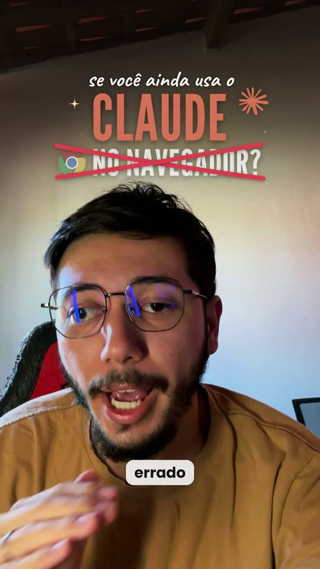
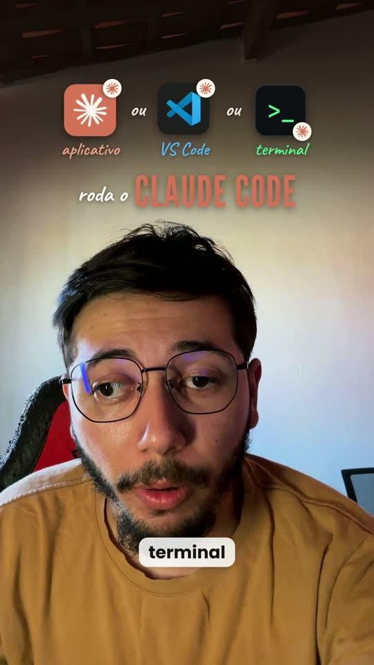
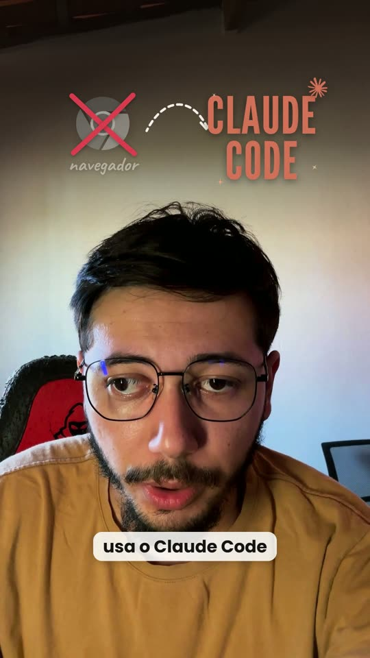
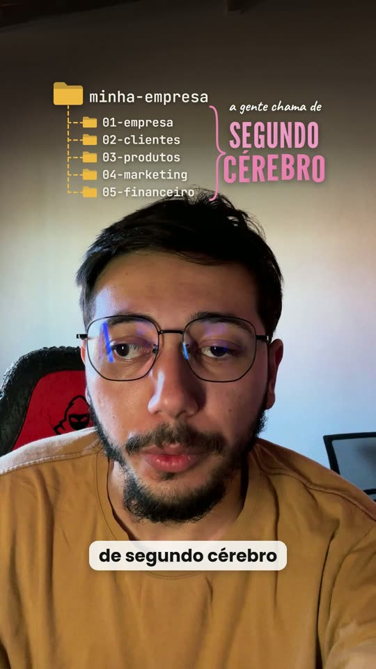

# Estilo Títulos Desenhados

A pessoa fala para a câmera e **o alto da tela ganha um título desenhado para cada trecho**: não um bloco de texto que troca, e sim uma pequena ilustração tipográfica feita para aquela fala. Uma palavra grande em letra condensada de caixa alta, uma frase de passagem em letra manuscrita, a cor tirada do assunto (o laranja de uma marca, o azul de um programa, o verde de um terminal) e desenhos que explicam o que ela diz: um X riscando, uma seta tracejada, uma árvore de pastas que se abre, um calendário virando, o logo de verdade entrando na palavra. Embaixo, uma legenda discreta numa caixinha clara. Fica natural e bonito, e serve para opinião, dica de ferramenta e comparação ("não use isto, use aquilo").

   

Nos exemplos, o vídeo é "ainda usando o Claude no navegador?": cinco títulos em 32 s, cada um com os seus desenhos. **Repare no tamanho:** os títulos ocupam quase toda a largura entre as margens e a palavra principal é enorme. Título pequeno e tímido é o erro mais comum neste estilo.

## Gravação

- **Parede livre acima da cabeça.** O título mora entre uns 230 e 600 px do alto (num vídeo de 1920). Com a cabeça alta no quadro, o título encolhe e passa perto do cabelo. Enquadre de peito para cima, com um palmo de parede acima da cabeça. Isto é o que mais pesa no estilo: no vídeo de exemplo, o cabelo chegava a 530 px no fim e apertou o último título.
- **Câmera fixa, um take**, falando para a lente. Gesto grande conta junto (as mãos, os braços abertos), porque a tela não troca.
- Parede clara ou escura serve: o alto é escurecido na edição.

## Na tela

| Elemento | Como é |
|---|---|
| **O alto escurecido** | Um degradê suave e fixo, do topo até uns 860 px (`td-sombra.html`, atrás de tudo, o vídeo inteiro). Ele dá contraste ao título em qualquer parede e não se mexe |
| **Onde fica o título** | Entre uns 230 e 600 px do alto, de 150 a 930 px na largura (a largura útil: 780 px). Nunca sobre a cabeça: onde o cabelo sobe, o título sobe junto (o comando `titulos` mede) |
| **Tamanho** | Ver "O tamanho dos títulos", logo abaixo. É regra, com número |
| **Tipografia** | A condensada de caixa alta (`var(--f-condensada)`, League Gothic) para a palavra de impacto; a manuscrita (`var(--f-lista)`, Caveat) para o que se diz de passagem ("se você ainda usa o", "roda o", "a gente chama de"); a mono (`var(--f-mono)`) para nome de pasta ou comando |
| **Cor do assunto** | A palavra grande na cor da coisa de que se fala: o laranja da marca citada, o azul do programa, o verde do terminal, o amarelo da pasta, o vermelho do erro. A cor da marca da pessoa entra quando o assunto é ela. Branco para o resto |
| **Desenhos que explicam** | X vermelho riscado à mão em dois traços (o errado), sublinhado, seta tracejada em arco (a troca), chave que junta uma lista, árvore de pastas que se abre (organização), calendário de destacar que vira até o mês (tempo), estrelinhas piscando em volta do que é bom |
| **Logos e ícones de verdade** | O ícone real de cada ferramenta citada, entrando na palavra que a nomeia (ver "Ícones") |
| **Respiro** | **De 30 a 40% do vídeo sem título.** O trecho que repete uma ideia já mostrada ("mas não usa no navegador", logo depois do título que já riscou o navegador) fica só com a legenda. Encher todos os trechos cansa |
| **Legenda** | Caixinha clara e arredondada (`leg-pilula`), branca translúcida, em Poppins Bold 50 px, de 2 a 4 palavras; a palavra falada fica escura e as que vêm ficam cinza, acendendo em sequência. Mantém o "?" e o "!" do fim. **Abaixo da barba e do queixo**, mesmo que entre um pouco na faixa de baixo que o Instagram cobre, sem encostar na borda |

### O tamanho dos títulos

Os títulos do vídeo aprovado são grandes, e o comprador que segue o guia sem número tende a fazer menores. A régua:

- **A palavra principal de cada título com pelo menos 110 px de fonte** na condensada (uns 80 px de letra de caixa alta), e de 120 a 240 px no normal. No vídeo de exemplo: 214 px no gancho ("CLAUDE"), 150 px na troca ("CLAUDE / CODE"), 124 px embaixo dos ícones, 112 px no "CÉREBRO" e 236 px no "2026". Pelo menos um título por vídeo com a palavra acima de 180 px.
- **O título ocupa de 60 a 95% da largura útil** (de 470 a 740 px dos 780 entre as margens), contando o logo e os desenhos ao lado. Os do exemplo ocupam de 89 a 98%.
- **Ícone e logo com 90 a 160 px**; o logo que é o assunto do título (o que é riscado, o que entra na fila) com pelo menos 140 px.
- **Detalhe pequeno nunca carrega a ideia sozinho:** barra de endereço, URL, rótulo e nome de pasta são apoio. Se a ideia é "no navegador", ela está na palavra grande ou no logo grande; o "claude.ai" numa barrinha, sozinho, ninguém lê no celular.
- **Nenhum texto com menos de 32 px de fonte.** O nome embaixo do ícone fica com 44 a 60 px; o nome de pasta, com 34 px no mínimo.

O comando `titulos` (em "Conferir antes de mostrar") mede isso sozinho e avisa o que ficou pequeno.

### Cada título é desenhado para o trecho

Não existe molde: cada título nasce da frase. Pergunte, para cada trecho, **o que se desenharia num quadro branco para explicar essa fala**, e faça isso com tipografia e desenho:

- **Uma opinião forte** ("você está errado"): a frase com a palavra-chave grande e o X riscando a parte errada; ela treme e perde a cor na palavra "errado".
- **Uma lista de opções** ("o aplicativo, o VS Code ou o terminal"): os ícones de verdade, um por palavra, com o nome manuscrito embaixo; a fila abre espaço para o próximo.
- **Uma troca** ("não use X, use Y"): o logo de X grande, riscado e apagado, a seta tracejada e Y grande do outro lado.
- **Organização** ("organize tudo numa pasta"): a árvore de pastas se abrindo, uma pasta depois da outra, e uma chave levando ao nome que se dá para ela.
- **Tempo** ("já é final de 2026"): o calendário virando as folhas até o mês e um algarismo do ano piscando.

**Varie de um título para o outro:** palavra grande com logo, fila de ícones, troca com seta, diagrama, objeto. Dois títulos iguais seguidos cansam.

## Movimento

**Antes de animar, escreva o `movimento.md`** do projeto: uma linha por título, com o principal e os princípios que entram ([princípios de movimento](../referencias/animacoes.md#princípios-de-movimento)). As funções do `td-base.js` já trazem os princípios no nome:

- **O título nasce na palavra:** a manuscrita digitada letra por letra no ritmo da fala (`tdDigita`); a palavra grande com antecipação (encolhe e desce um pouco antes), as letras chegando uma depois da outra e o achatar quando a última assenta (`tdPalavra`).
- **Logo e ícone entram em arco**, girando, e achatam ao pousar (`tdArco`).
- **Conjunto em sequência:** a fila de ícones abre espaço com um recuo antes de ir (`tdVai`); as pastas da árvore chegam a cada 0,11 s.
- **Tempos variados:** a palavra grande mais devagar que o ícone; o ícone mais devagar que a estrelinha.
- **Nada parado enquanto o título está na tela:** a faísca do logo girando devagar (`tdGira`), estrelinhas piscando em ritmos diferentes (`tdPisca`), a seta e os galhos com o tracejado correndo (`tdTracejado`), ícones boiando de leve (`tdBoia`), o algarismo pulsando. Texto não boia.
- **Desenho à mão** (`tdRisca`): o X, o sublinhado, a seta e a chave se desenham do começo ao fim, sem aparecer antes.
- **Saída curta**, subindo e acelerando, as partes uma depois da outra (`tdSai`), um pouco antes da próxima fala.

Dois cuidados com as funções:

- `tdBoia`: passe o id da peça que boia (o `.td-ic` do ícone), não uma classe. "#fila .td-svg" pega também o SVG do selo que está dentro do ícone (a função já ignora o que está dentro de outro escolhido, mas o id deixa claro o que se mexe).
- `tdApaga`: apaga o que foi riscado. Deixe o X (`.td-traco`) **fora** do elemento apagado, como nos exemplos; se ele estiver dentro, a função apaga só os irmãos dele e o X continua vermelho.

## Som

Efeitos baixos e variados, **só quando um título ou um elemento entra**, sem música: caneta ou marcador no que se escreve e se risca, pop no logo que pousa, swish no que voa, tons em escada na árvore de pastas (curtos, `"dura": 0.045`, para uma nota não pisar na outra), folha de papel no calendário, brilho nas estrelinhas, um erro curto no "errado". Nenhum efeito repetido no mesmo vídeo, a não ser a escada.

**Volume:** `"efeitos": {"ganho": -8}` no roteiro, e `"ganho": -3` a mais em cada pop, impacto e "appear" (são os que batem mais alto). O alvo é o pico dos efeitos na altura da fala ou abaixo. O `escutar` lista no fim os efeitos que passaram da voz e quanto baixar cada um: baixe e monte de novo.

## Ícones

Os ícones de marca entram de verdade, nunca redesenhados de cabeça. Na pasta de exemplos (`.ferramenta/skill/referencias/animacoes/`) estão prontos, já coloridos e feitos para ler sobre o alto escuro. Entram na marcação com `<!--#inclui td-icone-NOME.svg-->`, dentro de uma caixa com largura e altura:

| Arquivo `td-icone-...svg` | O que é | Origem e licença |
|---|---|---|
| `claude`, `claude-app` | A faísca do Claude (na cor do texto, `color`) e o ícone do app (quadrado laranja) | theSVG, CC0 |
| `chatgpt` | O logo da OpenAI, branco num quadrado preto (o ícone do app) | Simple Icons, CC0 |
| `gemini` | A estrela do Gemini, em degradê azul, roxo e rosa | o desenho do theSVG (CC0), com o degradê do logo |
| `cursor` | O cubo do Cursor num quadrado preto | theSVG, CC0 |
| `vscode`, `vscode-app` | O VS Code, solto e num quadrado escuro | theSVG, CC0 |
| `chrome` | O Chrome nas quatro cores | o desenho do theSVG (CC0), com as cores do logo |
| `google`, `planilhas-google` | O "G" colorido e o Planilhas Google | theSVG, CC0 |
| `notion`, `whatsapp`, `youtube`, `instagram`, `n8n` | Os logos nas cores deles | theSVG, CC0 |
| `github` | O gato branco num quadrado escuro | theSVG, CC0 |
| `planilha` | Uma planilha verde genérica, sem marca (para Excel e planilha em geral: o logo do Excel não tem licença livre) | desenhado aqui (MIT) |
| `terminal`, `pasta`, `estrela` (este é `td-estrela.svg`) | Terminal `>_` verde, pasta e estrela de quatro pontas na cor do texto | desenhados aqui (MIT) |

**Ícone que falta:** busque o logo oficial no theSVG, de graça:

```
npx hyperframes@0.9.9 media-use resolve --type logo --entity NOME --intent "NOME logo" --project .projetos/NOME
```

- O `--entity` é o nome curto da marca, tudo junto e em minúsculas, como no site dela: `notion`, `whatsapp`, `github`, `n8n`, `googlegemini`, `googlesheets`, `microsoftexcel`. Quando não acha, tente com hífen (`visual-studio-code` achou o VS Code, que `vscode` não achava), o nome da empresa (`google`, `microsoft`) ou o domínio sem o ".com".
- O arquivo sai em `.projetos/NOME/.media/images/`, e o `manifest.jsonl` do lado diz a licença (`"license"`). **Só use CC0.** Se vier MIT ou outra (aconteceu com a OpenAI e o Excel), procure no Simple Icons (CC0): `https://cdn.jsdelivr.net/npm/simple-icons@13.21.0/icons/NOME.svg`. Sem licença livre, desenhe um ícone genérico (como a `planilha`) e escreva o nome da ferramenta ao lado.
- **Logo de uma cor só** (muitos vêm assim): o desenho tem um `fill` só. Para pôr as cores do logo de verdade, separe o caminho em pedaços (cada `M...z` do `d` é uma parte) e dê a cada parte a cor dela, como no `td-icone-chrome.svg`; ou, se o logo de verdade é em degradê, troque o `fill` por um `linearGradient`, como no `td-icone-gemini.svg`. Logo escuro (preto) não aparece no alto escurecido: ponha dentro de um quadrado arredondado, como o ícone do app (`td-icone-github.svg`).
- Antes de incluir, tire do SVG o `<title>`, os comentários e o `<style>` (passe a cor para o `fill` de cada elemento), e troque cada `id="x"` por `id="td$IDx"` (e o `url(#x)` junto), para dois logos iguais no vídeo não se misturarem.

A marca continua sendo da empresa: use o logo só para citar a ferramenta de que se fala.

## Como montar

1. Corte normal (`tentativas` se houver repetições, `transcrever`, `cortar`). Não precisa de recorte.
2. **Ano, número e valor:** a transcrição erra o tempo deles. Para cada um que vai ter título entrando na hora, rode:

   ```
   python .ferramenta/sistema/editar.py retempo .projetos/NOME/corte/base.mp4 .projetos/NOME/corte/palavras.json DE ATE
   ```

   com `DE` e `ATE` em segundos, pegando a frase inteira em volta do número (uns 2 a 4 s). Ele ouve o trecho de novo, acha cada palavra no som (o número por extenso: "dois mil e vinte e seis"), mostra o antes e o depois, a energia do áudio com o começo de cada palavra marcado, e grava o `palavras.json` (o original fica em `palavras.antes-do-retempo.json`). `--so-mostrar` só mostra. Confira na energia que a palavra começa onde a barra sobe.
3. Divida a fala em trechos de ideia (3 a 6 s). Escolha os que ganham título e **deixe de 30 a 40% do vídeo sem título**. Para cada título, decida o desenho (ver acima) e escreva o `movimento.md`.
4. Crie um arquivo por título em `.projetos/NOME/animacoes/`, com `<!--#inclui td-base.css-->` no `<style>` e `<!--#inclui td-base.js-->` no `<script>`. Os exemplos são o vídeo inteiro: `td-gancho.html`, `td-icones.html`, `td-troca.html`, `td-arvore.html` e `td-calendario.html`. Leia, pegue o nível de acabamento **e o tamanho**, e desenhe os títulos do seu vídeo: **não copie**. A camada ocupa a tela toda em largura e as peças ficam em pixels da tela.
5. No `roteiro.json`:

```json
{
  "legenda": { "modo": "karaoke", "classe": "leg-pilula", "x": 0, "largura": 1080, "y": 1552,
               "caracteres": 20, "quebra_virgula": true, "juntas": ["VS Code", "Claude Code"] },
  "efeitos": { "ganho": -8 },
  "camadas": [
    { "tipo": "bloco", "arquivo": "td-sombra.html", "de": 0, "ate": 99, "x": 0, "y": 0, "largura": 1080, "atras": true, "som": false },
    { "tipo": "bloco", "arquivo": "gancho.html", "de": 0, "ate": "@Cara-0.07", "x": 0, "y": 0, "largura": 1080,
      "legenda_fica": true, "som": false,
      "rotulos": ["se você ainda usa o", "Claude", "no navegador?"],
      "marcas": [0.04, "@Claude", "@navegador", "@totalmente", "@errado"],
      "sons": [ { "em": "@Claude+0.06", "id": "pop-medium-in", "ganho": -3 }, { "em": "@totalmente", "id": "writing-marker-draw", "dura": 0.42 } ] }
  ]
}
```

   - **O `y` da legenda é o topo da caixinha** (a caixinha tem uns 90 px de altura). Ponha o topo logo abaixo do queixo e da barba: comece em 1.552 e confira no quadro; se o queixo descer mais, desça (até uns 1.610, para a base não passar de 1.700).
   - A legenda troca de frase no ponto, na vírgula (`"quebra_virgula"`) e na pausa da fala (mais de 0,3 s; mude com `"pausa"`): duas frases nunca dividem uma caixinha, mesmo sem ponto na transcrição.
   - `"juntas"`: nomes de duas palavras que a legenda não pode partir.
   - Cada título com `"legenda_fica": true` (senão a legenda desce para baixo dele) e `"som": false` (os efeitos vão em `"sons"`).
   - Título que vai até o fim do vídeo: `"ate": 99`.
6. `montar`, conferir (abaixo), `renderizar`, `escutar`, `finalizar`.

## Conferir antes de mostrar

**Primeiro a conferência automática**, depois de cada `montar`:

```
python .ferramenta/sistema/editar.py titulos .projetos/NOME/montagem .projetos/NOME/corte/base.mp4
```

Ela anda o vídeo a cada 0,2 s com a animação correndo e mede cada título: **encosta ou passa por cima da cabeça** (o topo da cabeça sai de um recorte rápido da pessoa, feito na primeira vez e guardado na montagem; se o projeto já tem `recorte.webm`, passe `--recorte`), **sai da área** (acima de 220 px, fora de 150 a 930 px), **palavra principal pequena** (menos de 110 px), **título estreito** (menos de 60% da largura útil), **texto miúdo** (menos de 32 px) e **legenda baixa** (base abaixo de 1.700 px). Diz o título, o texto, o segundo e quantos px subir. Corrija até sair "0 com problema". As estrelinhas de menos de 40 px podem passar um pouco da margem. No vídeo de exemplo, gravado com pouco espaço acima da cabeça, o comando acusa três títulos encostando no cabelo (de 4 a 56 px): é por isso que a gravação pede um palmo de parede livre.

**Depois o olho**, nos quadros (`npx hyperframes@0.9.9 snapshot --at ...`), um de cada título no meio e no fim dele e três da legenda:

| Pergunta | Régua |
|---|---|
| A legenda está fora da boca e da barba? | O topo da caixinha abaixo do queixo (o comando não vê a boca) |
| Entrou na hora? | Cada peça na palavra que a nomeia, não antes; número e ano acertados com o `retempo` |
| Tem respiro? | De 30 a 40% do vídeo sem título (some os trechos vazios) |
| Cada título é diferente do anterior e explica a fala? | Formato e desenho variam; nenhum parece molde; a ideia está no grande, não num detalhe |
| Os princípios aparecem nos quadros? | Antecipação na palavra grande, arco e achatar no logo, conjunto em sequência, algo vivo até a saída (pela tabela do [guia de animação](../referencias/animacoes.md#conferir-antes-de-mostrar)) |
| Nada cortado nem ilegível? | Palavra grande inteira (sem quebrar linha), manuscrita com sombra, contraste sobre o degradê |
| Os efeitos? | `escutar` com todos no lugar e nenhum na lista "acima da voz"; nenhum repetido |

**Avisos do check que são normais neste estilo** (o `renderizar` mostra cada aviso com o elemento que o gerou; confira se é um destes):

| Aviso | Por que aparece |
|---|---|
| `contrast_aa_failure` | As palavras cinza da legenda, que ainda vão ser faladas: cinza de propósito |
| `line_unread` | A legenda troca no ritmo da fala |
| `duplicate_audio_track` | Vários efeitos na mesma trilha |
| `nested_structure_needs_subcomposition`, `timeline_track_too_dense`, `composition_file_too_large` | Vêm do jeito que o `montar` junta as animações e a legenda num arquivo só |
| `text_occluded` | O X riscando a palavra e a faísca no canto do ícone ficam por cima de propósito |
| `container_overflow`, `escaped_container`, `canvas_overflow` | A camada do título tem altura zero e as peças ficam em pixels da tela, fora da caixa dela; e o logo que entra em arco começa fora do lugar |

Aviso desses num elemento que não é título nem legenda, ou um aviso que não está na lista, é para olhar no quadro.

## Num corte de live

Teste de 2026-11-26, no corte "Bruxismo, a raiva que ficou calada" (16 s), aguardando a aprovação do Vitório:

- **O vídeo desce 400 px** (`live.py abrir-topo ... --px 400`) e **os títulos sobem uns 40 px**, começando por volta de 180 a 200 px do alto, um pouco acima da regra dos 220 (Vitório, 2026-11-26: "sobe tudo um pouco, para a cabeça dela aparecer mais"; mais que isso, o Instagram corta). O `titulos` avisa "fora da área" por isso: é esperado. O que não pode é "encosta na cabeça": ela levanta a cabeça em vários momentos, então confira e suba ou diminua a peça de baixo. O alto escurecido cobre a parede desfocada, e o título claro fica forte.
- **Títulos do assunto dela:** BRUXISMO (azul claro da marca, `#9FD3E6`) com "maxilar tenso" à mão e um zigue-zague dos dentes a ranger; RAIVA (vermelho `#EF5A5F`) com "que ficou calada" e uma boca costurada que se desenha em "não disse"; PASSADO (cinza) → seta tracejada → AGORA (azul claro). Sem estrelas no assunto pesado.
- **Legenda:** num corte em que ela fica muito perto da câmera, não há lugar que nunca toque no rosto. Em `"y": 1600` ela fica abaixo da boca na maior parte do tempo; mais baixo, o Vitório achou que ela quase não aparecia.
- **Efeitos baixos** (`"ganho": -8`), um por título.
- **Vídeo completo** (2026-11-26, aguardando a opinião do Vitório): "Se o sintoma falasse" (44 s), seis títulos e três respiros (o aviso "autoanálise, não consulta", o "é mais estranha" e a pergunta repetida). 3 PERGUNTAS com o 3 enorme; QUANDO? com um relógio que se desenha e gira; PRIMEIRA VEZ com a seta tracejada voltando para trás; FALASSE dentro de um balão de fala; "fechem os olhos" com o olho fechado, 3 SEGUNDOS e uma barra que enche; OUVIR com ondas de som dos dois lados. A linha à mão de cima fica em 180 px; o que fica embaixo do título, até uns 530 px (o cabelo chega a 540 quando ela se inclina). Efeito que cai numa pausa da fala (o whoosh do QUANDO?) sobressai: baixe mais 6.

## O que já foi corrigido neste estilo

- **Legenda abaixo da barba**, não em cima: em cima da barba ela fica estranha, mesmo sem cobrir a boca. Vale descer até entrar um pouco na faixa de baixo que o Instagram cobre.
- **Parede livre acima da cabeça na gravação.** Com pouco espaço, o título aperta contra o cabelo; a gravação é que se ajusta ao estilo, não o contrário.
- **Títulos grandes:** num teste, os títulos saíram menores e mais tímidos que os do vídeo aprovado, e uma barra de endereço com "claude.ai" ficou ilegível. Daí a régua de tamanho e o comando `titulos`.
- **Efeitos baixos:** no volume padrão, os pops ficavam de 8 a 11 dB acima da voz.
- **Notas da escada curtas:** com o som inteiro, uma nota soava por cima da seguinte.
- **A legenda mantém o "?" e o "!"**, e não junta duas frases numa caixinha só.
