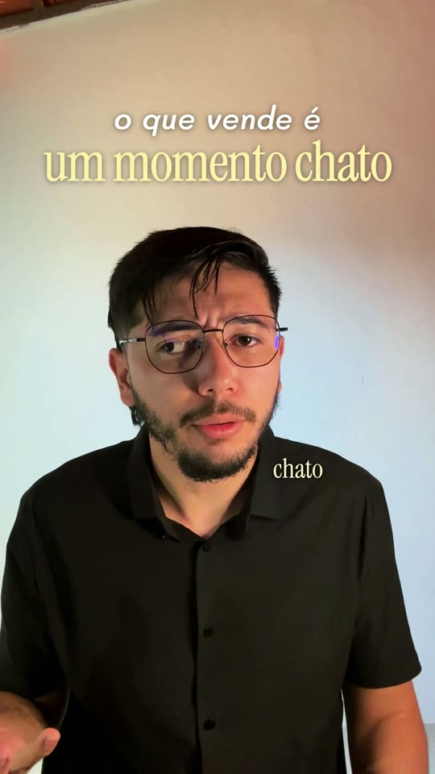
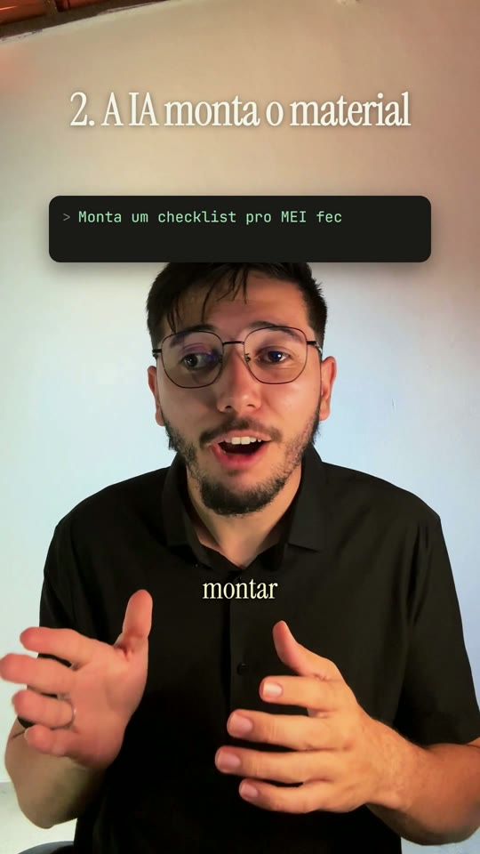
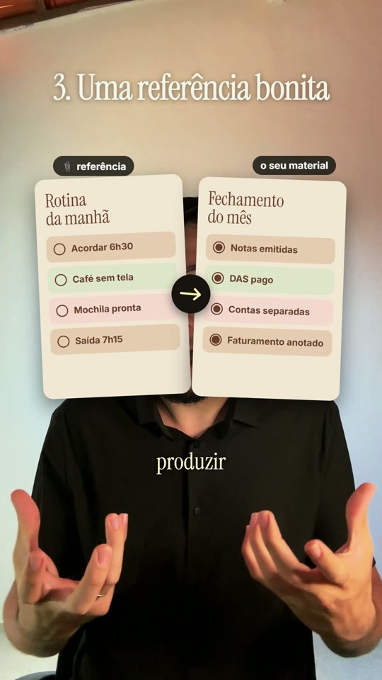
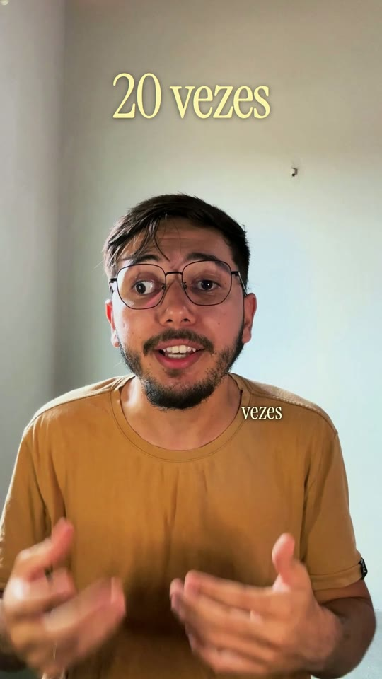

# Estilo Yap

A pessoa fala para a câmera e **o topo da tela resume cada ideia**: um título serifado grande, uma frase manuscrita de apoio, a palavra forte em destaque. A legenda fica pequena, palavra por palavra, **ao lado do rosto**. Quando ela fala de um sistema, um material ou um resultado, uma animação entra na frente, por pouco tempo. Bom para dica, lista, opinião e venda de produto, que é o vídeo falado mais comum das redes. (No editor do Vitório e no produto ele se chama Estilo Título.)

   

## Gravação

- Olhando e falando para a câmera, de peito para cima, com **espaço livre acima da cabeça** (é ali que o título mora).
- Câmera parada, vídeo em pé. Fundo simples: uma parede, uma estante discreta.

## Na tela

| Elemento | Como é |
|---|---|
| Título do bloco | Serifado, grande (110 a 150 px), no topo, a partir de uns 220 px. Muda a cada ideia: cada bloco do roteiro tem o seu |
| Frase de apoio | Manuscrita (`"f": "mao"`), menor, acima ou abaixo do título, entrando na hora da fala, às vezes digitando |
| Palavra forte | Em destaque (`"f": "destaque"`, a cor de destaque da marca), maior que o resto, entrando na palavra |
| Lista | Um item por bloco, com o número no título ("1. Um momento chato"), e o detalhe manuscrito embaixo |
| Virada | `riscado`: a ideia errada riscada e a certa entrando embaixo |
| Valor | Em destaque, entrando no instante em que é falado, com som de dinheiro |
| Animação de sistema | `bloco` na frente, cobrindo o rosto por **6 a 7 s no máximo** (9 s já fica longo). Entra na palavra que ela mostra e sai na troca de bloco. Fiel ao sistema de verdade: o terminal com o pedido sendo digitado, a lista sendo montada, a conversa chegando. Peça inteira, sem vãos por onde a boca aparece |
| Legenda | Serifada, pequena (66 px), palavra por palavra, **ao lado do rosto**, na cor clara da marca. Com animação grande na tela, ela desce para logo abaixo dela (o motor faz isso sozinho) |
| Zoom | Pouco: empurrão curto até 1,06 numa palavra forte, corte seco para 1,08 na frase de impacto, aproximação lenta até 1,05 numa lista, e volta seca para 1 na troca de bloco |

- **Variar o formato de um bloco para o outro:** título sozinho, título com apoio, palavra gigante, riscado, lista. Dois blocos iguais seguidos cansam.
- **O título fica perto da cabeça:** o fim do texto logo acima do cabelo, sem vão grande e sem encostar. Confira nos quadros, porque a cabeça muda de altura com o zoom.
- **Pouco emoji.**
- **Nome de ferramenta com o ícone dela** quando aparecer (o ícone de verdade, como SVG).
- **A animação mostra só o que ela está falando naquele instante,** e com vida: um personagem fazendo algo agrada mais que uma tela parada.
- **No fim,** a animação sai antes de a pessoa fechar a fala; o pedido final ("comenta X", "me segue") é um título como os outros.

## Som

Clique em cada texto que entra, swish em imagem e animação, dinheiro em valor, teclado em linha digitada, caneta no risco. Som literal e pontual quando a fala pedir (uma buzina, um erro no ✕), escolhido à mão. Sem pop. Efeitos um pouco abaixo do padrão: `"efeitos": {"ganho": -2}`.

## Num corte de live

Teste de 2026-11-26, no corte "Bruxismo, a raiva que ficou calada" (16 s), aguardando a aprovação do Vitório:

```json
{
  "legenda": { "classe": "leg-serifa", "x": 90, "largura": 900, "y": 495, "cor": "#1E293B" },
  "css": ".topo { color: #1E293B; text-shadow: 0 0 22px rgba(255,255,255,.75), 0 0 6px rgba(255,255,255,.6); } .topo .mao, .topo .manuscrita { color: #2F6478; text-shadow: 0 0 18px rgba(255,255,255,.9), 0 0 5px rgba(255,255,255,.8); } .topo .destaque { color: #2F6478; } .leg-serifa { font-size: 58px; text-shadow: 0 0 14px rgba(255,255,255,.8); } .topo::before { content: ''; position: absolute; left: -80px; right: -80px; top: -70px; bottom: -110px; z-index: -1; background: radial-gradient(ellipse at 50% 50%, rgba(246,240,231,.82) 0%, rgba(246,240,231,.55) 45%, rgba(246,240,231,0) 72%); }",
  "efeitos": { "ganho": -6 },
  "camadas": [
    { "tipo": "serifa", "de": 0, "ate": "@Normalmente", "texto": "Bruxismo", "manuscrita": "maxilar tenso", "digita_em": "@maxilar", "tamanho": 140, "y": 225 },
    { "tipo": "texto", "de": "@Normalmente", "ate": "@A#2", "y": 225, "esconde_legenda": true, "linhas": [
      { "t": "Está ligado à", "f": "serifa", "tamanho": 104 }, { "t": "raiva", "f": "destaque", "tamanho": 160, "em": "@raiva" } ] },
    { "tipo": "texto", "de": "@A#2", "ate": "@Pode#2", "y": 225, "linhas": [
      { "t": "A raiva", "f": "serifa", "tamanho": 140 }, { "t": "que ficou calada", "f": "mao", "digita": true, "em": "@calada", "tamanho": 74 } ] }
  ]
}
```

O vídeo é o `base-topo.mp4` do [cortes-de-live.md](../referencias/cortes-de-live.md) (o vídeo desce 380 px e o topo é a parede do alto do quadro, desfocada).

## Como montar

1. Corte normal (`tentativas` se houver repetições, `transcrever`, `cortar`). Não precisa de recorte.
2. Divida a fala em blocos de ideia (de 2 a 5 s cada) e escreva o título de cada um.
3. No `roteiro.json`:
   - `"legenda": {"classe": "leg-serifa", "x": 480, "largura": 520, "y": 1130, "cor": "destaque"}`. O `x` e o `y` põem a legenda ao lado do rosto: confira no quadro e ajuste para o lado em que a pessoa tem mais espaço.
   - O gancho numa camada `serifa` (o título com a frase manuscrita digitando).
   - Cada bloco numa camada `texto` com `y` por volta de 240 e `linhas` misturando `serifa`, `mao` e `destaque`.
   - As animações em `bloco`, e camadas `zoom`.
4. `montar`, olhar os quadros, `renderizar`, `escutar`, `finalizar`.

**Anúncio:** animação nova a cada criativo. O Facebook trata criativo parecido como igual.
